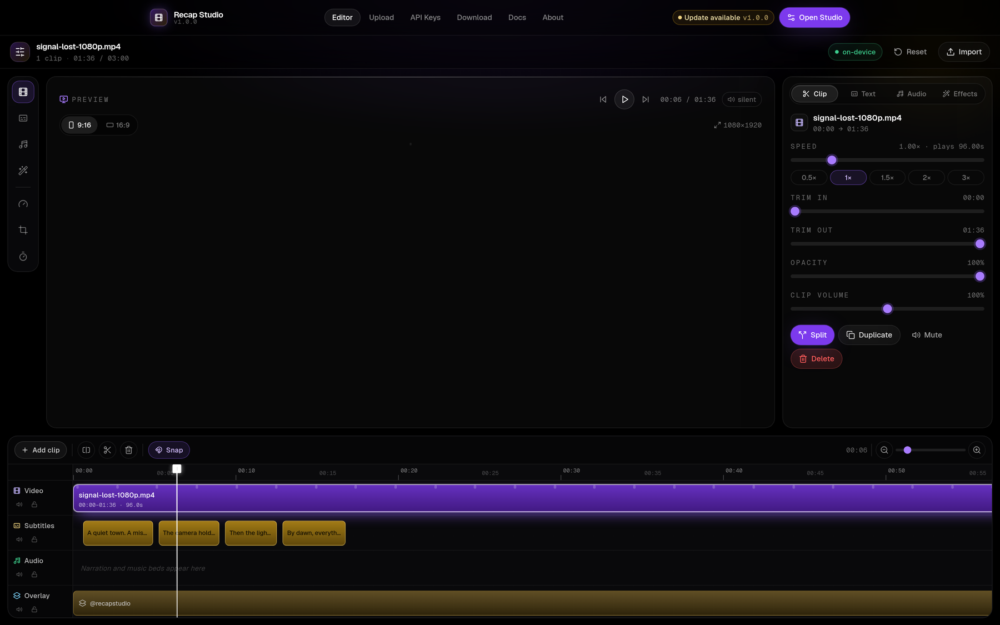
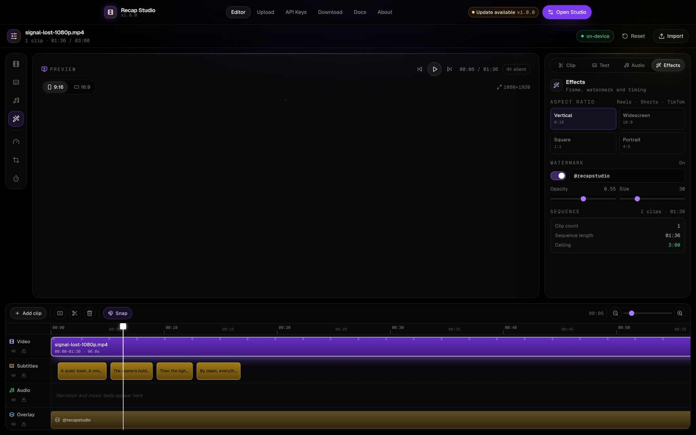
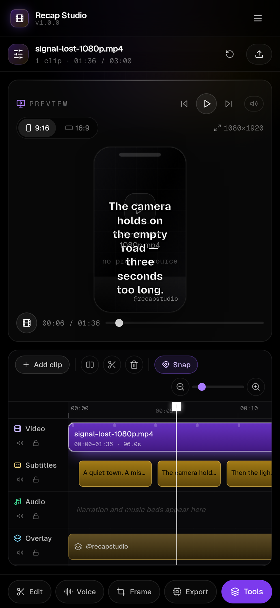
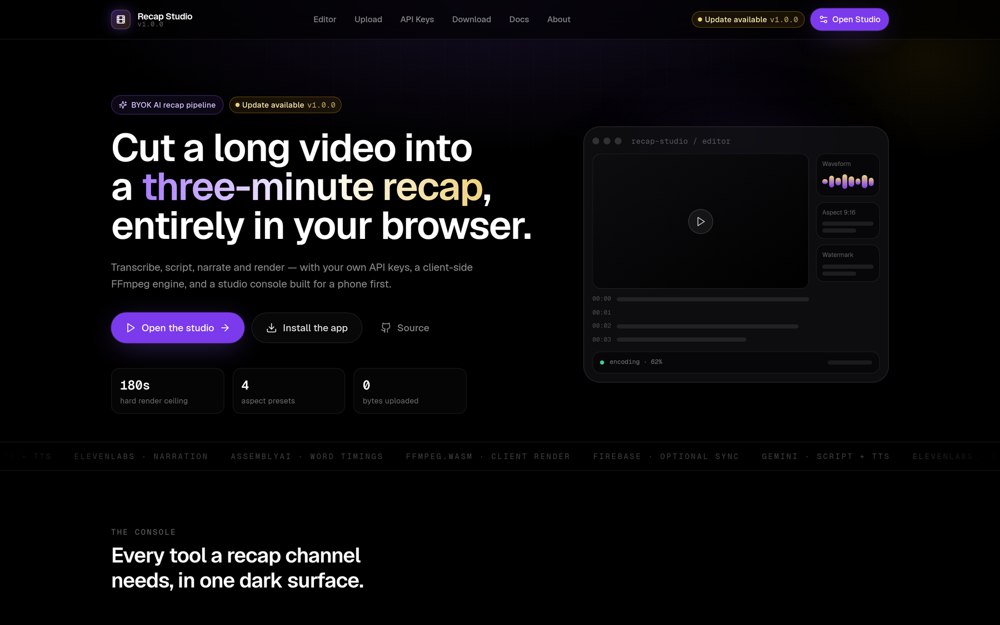
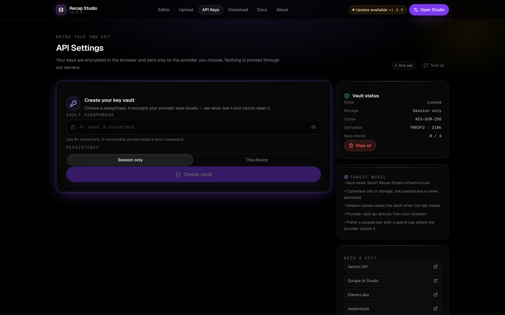
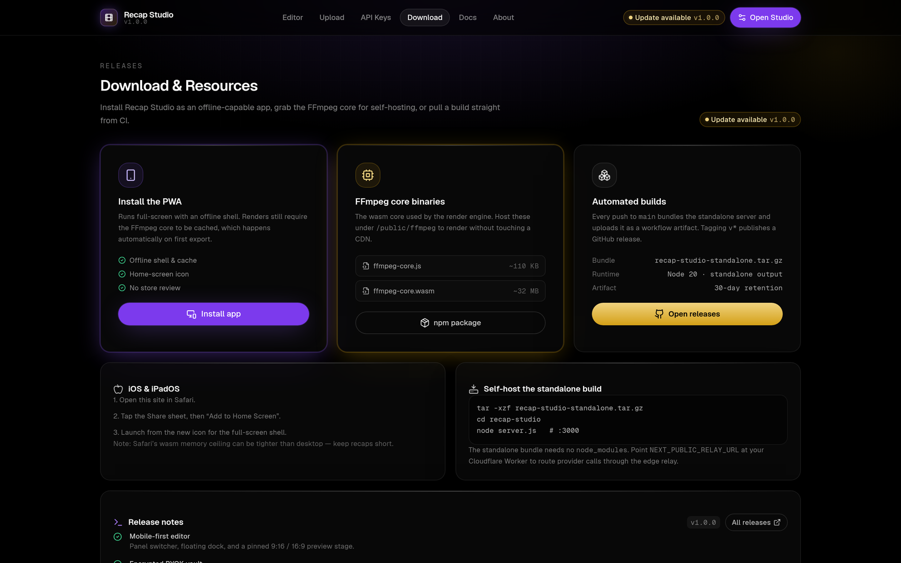

# Recap Studio

A hyper-modern, mobile-first video recap workstation. Transcribe a source, compress it
into a three-minute script, generate narration, and render the finished cut — all in
the browser, with your own API keys.

Built with Next.js 14 (App Router), Tailwind, Framer Motion, Zustand and FFmpeg.wasm.

## Screenshots

The studio is a single dark console with three surfaces: a marketing/landing shell, an
NLE-style editor, and the supporting hubs for keys, sources and releases.

### Editor — the multitrack NLE

<p align="center">
  
</p>
<p align="center"><sub><b>Desktop editor</b> — tool rail · preview stage · context inspector · multitrack timeline (video, subtitles, audio, overlay).</sub></p>

<table>
  <tr>
    <td width="50%" valign="top">
      
      <p align="center"><sub><b>Inspector</b> — aspect ratio, watermark layer and sequence timing.</sub></p>
    </td>
    <td width="50%" valign="top">
      
      <p align="center"><sub><b>Mobile editor</b> — stage over timeline, with tools in a bottom sheet.</sub></p>
    </td>
  </tr>
</table>

### Hubs

<table>
  <tr>
    <td width="50%" valign="top">
      
      <p align="center"><sub><b>Landing</b> — the pitch-black hero and signal gradient.</sub></p>
    </td>
    <td width="50%" valign="top">
      
      <p align="center"><sub><b>API Settings</b> — encrypted vault and per-provider key cards.</sub></p>
    </td>
  </tr>
  <tr>
    <td width="50%" valign="top">
      
      <p align="center"><sub><b>Download</b> — PWA install, FFmpeg core and CI releases.</sub></p>
    </td>
    <td width="50%" valign="top">
      <p align="center" style="padding-top:2rem">
        <sub>Regenerate all six with <code>npm run screenshots</code><br />(dev server running + Playwright installed).</sub>
      </p>
    </td>
  </tr>
</table>

## Highlights

- **NLE-style editor.** A four-lane multitrack timeline (video, subtitles, audio,
  overlay) with draggable clips, edge-trim handles, split at the playhead, magnetic
  snapping and a zoomable ruler — the CapCut / Alight Motion interaction model.
- **BYOK, encrypted.** Provider keys live in an AES-GCM-256 vault behind a passphrase
  you choose. Nothing is proxied through a server.
- **Client-side rendering.** The whole encode runs in a wasm worker via `@ffmpeg/ffmpeg`;
  footage never leaves the device.
- **Three-minute discipline.** The 180-second ceiling is enforced before the encode and
  again inside the argument vector.
- **Multi-provider narration.** ElevenLabs or Gemini TTS, with a live waveform and
  instant MP3/WAV export.
- **Mobile-first console.** Floating bottom dock, panel switcher, and an inspector that
  becomes a bottom sheet on a phone.

## Getting started

```bash
npm install
npm run fetch:ffmpeg   # optional: bundle the wasm core for offline rendering
npm run dev            # http://localhost:3000
```

Open `/api-settings`, create a vault passphrase, and paste at least one provider key.
Then `/upload` to bring in a source, and `/editor` to cut it.

### Scripts

| Script | Purpose |
| --- | --- |
| `npm run dev` | Development server |
| `npm run build` | Production build (standalone output) |
| `npm run start` | Serve the production build |
| `npm run lint` | ESLint |
| `npm run typecheck` | `tsc --noEmit` |
| `npm run fetch:ffmpeg` | Download the FFmpeg core into `public/ffmpeg` |
| `npm run screenshots` | Regenerate the README screenshots (needs `npm run dev` + Playwright) |
| `npm run relay:dev` | Run the Cloudflare Worker relay locally |
| `npm run relay:deploy` | Deploy the relay |

## Using the editor

### The multitrack timeline

| Lane | Holds | Interactions |
| --- | --- | --- |
| **Video** | Clips cut from the source | Drag to move, drag an edge to trim, split, duplicate, mute |
| **Subtitles** | Cue blocks | Drag to retime, drag an edge to resize, double-click to delete |
| **Audio** | Narration and the music bed | Read-only blocks reflecting the loaded audio |
| **Overlay** | The watermark layer | Read-only block reflecting the overlay settings |

Every lane has its own **mute** and **lock** toggle. Locking a lane blocks edits on it
without hiding the blocks, which is how you protect a finished pass.

Clips carry a *source window* (`in`/`out`) and a *sequence position* (`start`). Trimming
changes the window; moving changes the position; splitting produces two clips sharing the
same source. Changing a clip's speed rescales its sequence duration, so the sequence
length is always derived, never stored.

### Keyboard shortcuts

| Key | Action |
| --- | --- |
| `Space` | Play / pause |
| `S` | Split the selected clip at the playhead |
| `D` | Duplicate the selected clip |
| `Delete` / `Backspace` | Delete the selected clip |
| `←` / `→` | Nudge the playhead 0.1s (hold `Shift` for 1s) |

Shortcuts are ignored while a text field has focus.

### The inspector

Four context tabs, and the panel follows what you last touched on the timeline — tapping a
clip opens **Clip**, tapping a subtitle block opens **Text**.

- **Clip** — speed presets, trim in/out, opacity, clip volume, split/duplicate/mute/delete.
- **Text** — per-cue text and timing, plus the subtitle style (size, margin, bold, caps, box).
- **Audio** — narration playback and the music-bed level.
- **Effects** — aspect ratio, watermark layer, and sequence timing against the ceiling.

## Configuration

Everything is optional — the studio runs fully client-side with nothing set. See
`.env.example`.

| Variable | Effect |
| --- | --- |
| `NEXT_PUBLIC_RELAY_URL` | Route provider calls through your Cloudflare Worker |
| `NEXT_PUBLIC_FIREBASE_*` | Enable Google / SMS-OTP sign-in; absent → local profile |

## Architecture

```
src/
├── app/                    Routes: landing, login, editor, upload, api-settings, docs, download, about
├── components/
│   ├── ui/                 Button, GlassPanel, AnimatedModal, UpdateBadge, StatusPill, SecureInput, Segmented
│   ├── editor/
│   │   ├── video-timeline.tsx    Multitrack NLE surface (ruler, four lanes, playhead, trim handles)
│   │   ├── inspector.tsx         Tool rail + the four context panels
│   │   ├── preview-stage.tsx     9:16 / 16:9 stage driven by the clip sequence
│   │   ├── subtitle-timeline.tsx SRT cue list and the typewriter read-through
│   │   ├── tts-voice-engine.tsx  ElevenLabs / Gemini narration with a live waveform
│   │   ├── media-overlay.tsx     Aspect, watermark, subtitle styling, music bed
│   │   └── ffmpeg-exporter.tsx   Render progress and the 3-minute ceiling meter
│   └── common/             navbar, floating-dock, page-shell, providers
├── lib/
│   ├── api/                client-router (proxy + probes), gemini, elevenlabs, assemblyai
│   ├── ffmpeg/             render-engine (filter graph, ASS subtitles, exec)
│   ├── firebase/           config, auth
│   └── utils/              srt-parser, secure-storage (vault), format, cn
└── store/                  use-editor-store (clips, cues, playback), use-api-keys-store
```

### The clip model

```ts
interface Clip {
  id: string;
  sourceRef: string;   // which media file
  inSec: number;       // trim in  (source time)
  outSec: number;      // trim out (source time)
  startSec: number;    // position on the sequence
  speed: number;       // 0.25 – 4
  volume: number;      // 0 – 2
  opacity: number;     // 0 – 1
  muted: boolean;
}
```

`clipDuration = (out - in) / speed`, and the sequence length is the maximum clip end —
there is no separate duration field to drift out of sync. The preview maps sequence time
onto source time with `sequenceToSource()`, so a trim is visible immediately.

### How a render is built

`buildCommand()` composes a single `-filter_complex` graph: scale + pad to the target
frame, fade in/out, burn the generated ASS subtitle script, stamp the watermark, then
mix narration over the music bed. `buildAssSubtitles()` writes the cue list as ASS so
the burned-in text carries the studio's styling rather than ffmpeg's defaults.

## Security notes

- The vault passphrase is never persisted and cannot be recovered.
- The service worker explicitly refuses to cache provider responses or relay traffic.
- The edge relay allow-lists provider hosts and applies a per-IP token bucket.
- In development only, the stores are exposed on `window.__recapStore` for debugging and
  browser automation. The bridge is compiled out of production bundles.

## Deployment

`next build` emits a standalone server. Tag a `v*` commit to publish a GitHub release
with the bundle and FFmpeg core; see `.github/workflows/build.yml`.

```bash
tar -xzf recap-studio-standalone.tar.gz
cd recap-studio && node server.js   # :3000
```

## Known limitations

- A real end-to-end render has not been exercised in CI — it needs a browser with
  `SharedArrayBuffer` and an actual video file. The filter graph is unverified at runtime.
- The FFmpeg core is not committed (the wasm is ~32 MB). Fetch it with
  `npm run fetch:ffmpeg`, or let the engine fall back to the jsDelivr CDN.
- Wasm encoding is CPU-bound, and mobile Safari caps wasm memory lower than desktop.
- YouTube intake registers the source; transcription needs the media file itself.

## Licence

MIT.
 
