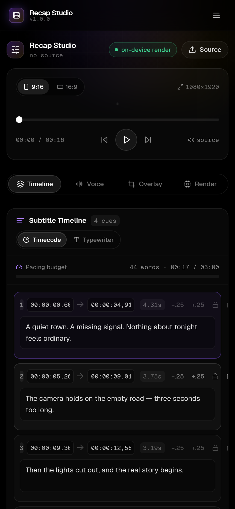

# Recap Studio

A hyper-modern, mobile-first video recap workstation. Transcribe a source, compress it
into a three-minute script, generate narration, and render the finished cut — all in
the browser, with your own API keys.

Built with Next.js 14 (App Router), Tailwind, Framer Motion, Zustand and FFmpeg.wasm.

## Screenshots

<table>
  <tr>
    <td width="50%" valign="top">
      
      <p align="center"><sub><b>Landing</b> — the pitch-black hero, signal gradient and studio mockup.</sub></p>
    </td>
    <td width="50%" valign="top">
      
      <p align="center"><sub><b>Editor</b> — mobile 9:16 stage, pacing budget and the SRT timeline.</sub></p>
    </td>
  </tr>
  <tr>
    <td width="50%" valign="top">
      
      <p align="center"><sub><b>API Settings</b> — the encrypted vault gate and per-provider key cards.</sub></p>
    </td>
    <td width="50%" valign="top">
      
      <p align="center"><sub><b>Download</b> — PWA install, FFmpeg core binaries and CI releases.</sub></p>
    </td>
  </tr>
</table>

## Highlights

- **BYOK, encrypted.** Provider keys live in an AES-GCM-256 vault behind a passphrase
  you choose. Nothing is proxied through a server.
- **Client-side rendering.** The whole encode runs in a wasm worker via `@ffmpeg/ffmpeg`;
  footage never leaves the device.
- **Three-minute discipline.** The 180-second ceiling is enforced before the encode and
  again inside the argument vector.
- **Multi-provider narration.** ElevenLabs or Gemini TTS, with a live waveform and
  instant MP3/WAV export.
- **Mobile-first console.** Floating bottom dock, panel switcher, pinned 9:16 / 16:9
  preview stage.

## Getting started

```bash
npm install
npm run fetch:ffmpeg   # optional: bundle the wasm core for offline rendering
npm run dev            # http://localhost:3000
```

Open `/api-settings`, create a vault passphrase, and paste at least one provider key.

### Scripts

| Script | Purpose |
| --- | --- |
| `npm run dev` | Development server |
| `npm run build` | Production build (standalone output) |
| `npm run start` | Serve the production build |
| `npm run lint` | ESLint |
| `npm run typecheck` | `tsc --noEmit` |
| `npm run fetch:ffmpeg` | Download the FFmpeg core into `public/ffmpeg` |
| `npm run screenshots` | Regenerate the README screenshots (needs `npm run dev` + Playwright) |
| `npm run relay:dev` | Run the Cloudflare Worker relay locally |
| `npm run relay:deploy` | Deploy the relay |

## Configuration

Everything is optional — the studio runs fully client-side with nothing set. See
`.env.example`.

| Variable | Effect |
| --- | --- |
| `NEXT_PUBLIC_RELAY_URL` | Route provider calls through your Cloudflare Worker |
| `NEXT_PUBLIC_FIREBASE_*` | Enable Google / SMS-OTP sign-in; absent → local profile |

## Architecture

```
src/
├── app/                    Routes: landing, login, editor, upload, api-settings, docs, download, about
├── components/
│   ├── ui/                 Button, GlassPanel, AnimatedModal, UpdateBadge, StatusPill, SecureInput, Segmented
│   ├── editor/             subtitle-timeline, tts-voice-engine, media-overlay, ffmpeg-exporter, preview-stage
│   └── common/             navbar, floating-dock, page-shell, providers
├── lib/
│   ├── api/                client-router (proxy + probes), gemini, elevenlabs, assemblyai
│   ├── ffmpeg/             render-engine (filter graph, ASS subtitles, exec)
│   ├── firebase/           config, auth
│   └── utils/              srt-parser, secure-storage (vault), format, cn
└── store/                  use-editor-store, use-api-keys-store
```

### How a render is built

`buildCommand()` composes a single `-filter_complex` graph: scale + pad to the target
frame, fade in/out, burn the generated ASS subtitle script, stamp the watermark, then
mix narration over the music bed. `buildAssSubtitles()` writes the cue list as ASS so
the burned-in text carries the studio's styling rather than ffmpeg's defaults.

## Security notes

- The vault passphrase is never persisted and cannot be recovered.
- The service worker explicitly refuses to cache provider responses or relay traffic.
- The edge relay allow-lists provider hosts and applies a per-IP token bucket.

## Deployment

`next build` emits a standalone server. Tag a `v*` commit to publish a GitHub release
with the bundle and FFmpeg core; see `.github/workflows/build.yml`.

```bash
tar -xzf recap-studio-standalone.tar.gz
cd recap-studio && node server.js   # :3000
```

## Licence

MIT.
 
